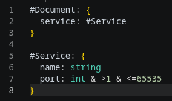
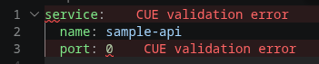

# CUE Validator

Catch configuration mistakes before they reach production.

A VS Code extension. Search for "cue-validator".

CUE Validator helps you validate the currently open YAML, JSON, or TOML file against the nearest local `.cue` schema in your workspace. It gives you instant feedback while you edit, so schema drift, missing fields, and invalid values are caught early instead of during deployment.

Validate against a local .cue schema with support for:
- YAML
- JSON
- TOML
- as well as other related data files 

## Screenshots

## Recommended

Install Error Lens (usernamehw.errorlens) for enhanced error highlighting

## Feature requests

If you encounter an issue or want to see a feature, simply open an issue here on github. We'd love to hear from you.
